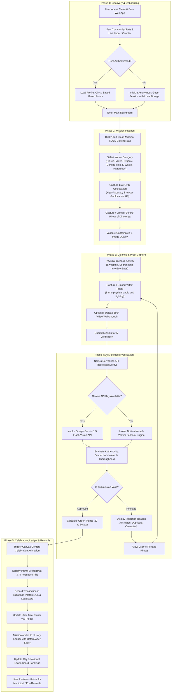
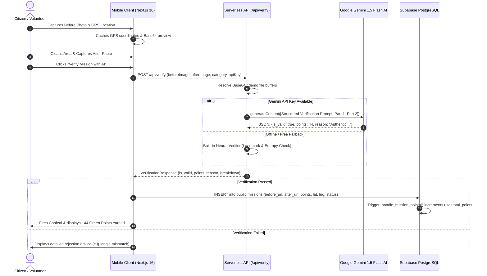
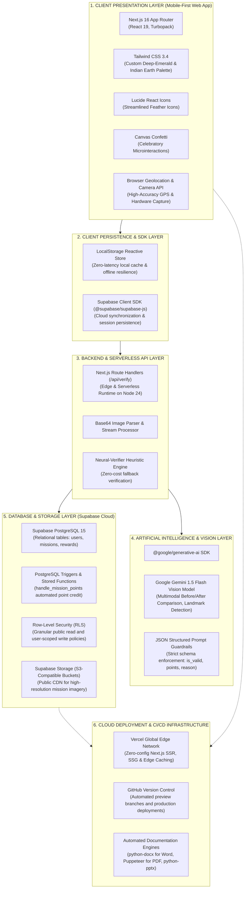

# Clean & Earn (सफ़ाई साथी) — User Flow, UI/UX Architecture & Technology Diagram

---

## 1. Executive Summary

**Clean & Earn** is a full-stack, mobile-first environmental action platform that gamifies community cleanliness. By combining real-time mobile image capture, automated GPS geotagging, Google Gemini Vision AI verification, and an instant Green Points reward economy, the platform transforms individual cleanup efforts into verifiable civic impact.

---

## 2. Detailed End-to-End User Flow

The complete user journey is structured into five distinct phases: **Discovery & Onboarding**, **Mission Setup**, **Physical Cleanup & Proof Capture**, **AI Multimodal Verification**, and **Reward Accumulation & Recognition**.

---

## 3. UI / UX Flow & Screen State Machine

The interface follows a mobile-first paradigm designed for high visibility under outdoor sunlight, quick thumb navigation, and low cognitive load.

### Screen Navigation & State Transition Diagram

```mermaid
stateDiagram-v2
    [*] --> DashboardScreen: App Launch

    state DashboardScreen {
        [*] --> ViewHeroMetrics
        ViewHeroMetrics --> CategoryFilter
        ViewHeroMetrics --> QuickStartFAB
        ViewHeroMetrics --> ViewRecentMissions
    }

    DashboardScreen --> MissionWizardScreen: Click "Start Clean Mission"
    DashboardScreen --> HistoryLedgerScreen: Click "History" in BottomNav
    DashboardScreen --> LeaderboardScreen: Click "Leaderboard" in BottomNav
    DashboardScreen --> SettingsModal: Click Settings Gear (Top Navbar)
    DashboardScreen --> AuthModal: Click User Profile Avatar

    state MissionWizardScreen {
        [*] --> Step1_BeforeSetup
        Step1_BeforeSetup --> Step2_AfterProof: Before Photo + GPS Confirmed
        Step2_AfterProof --> Step1_BeforeSetup: Back to Edit Before State
        Step2_AfterProof --> Step3_Verifying: Click "Verify Mission with AI"
        
        state Step3_Verifying {
            [*] --> AnalyzingLandmarks
            AnalyzingLandmarks --> CalculatingVolume
            CalculatingVolume --> ScoringThoroughness
        }

        Step3_Verifying --> Step4_Success: Verification Passed (is_valid = true)
        Step3_Verifying --> Step4_Rejected: Verification Failed (is_valid = false)

        Step4_Rejected --> Step2_AfterProof: Retry with New Photo
        Step4_Success --> HistoryLedgerScreen: Click "View in History"
    }

    state HistoryLedgerScreen {
        [*] --> MissionList
        MissionList --> InteractiveComparisonView: Select Mission Card
        InteractiveComparisonView --> MissionList: Back to List
    }

    state LeaderboardScreen {
        [*] --> NationalRankings
        NationalRankings --> CityRankings: Toggle Scope Filter
    }

    HistoryLedgerScreen --> DashboardScreen: Click "Home" in BottomNav
    LeaderboardScreen --> DashboardScreen: Click "Home" in BottomNav
```

### Key UI / UX Component Highlights

| Screen / Component | Purpose & UX Feature | Interaction Details |
| :--- | :--- | :--- |
| **Top Navbar** | Persistent identity & context header | Shows user profile avatar, active city (`New Delhi`), live Green Points counter pill, and settings modal trigger. |
| **Dashboard** | Primary landing screen | High-impact hero card showing total points, dynamic motivational quote, 1-tap "Start Clean Mission" CTA, and quick demo test triggers. |
| **Waste Category Picker** | Step 1 selection grid | 6 tactile cards with emoji icons (Plastic `🥤`, Mixed `🗑️`, Organic `🍂`, Construction `🧱`, E-Waste `🔋`, Hazardous `⚠️`). |
| **GPS Geotagger** | Automatic spatial verification | Uses `navigator.geolocation` with fallback handling; displays pinpoint latitude/longitude badges with accuracy status (`Acquiring`, `Success`, `Fallback`). |
| **Before / After Uploaders** | Dual-state proof capture | Supports live camera capture (`capture="environment"`) or direct gallery upload with immediate preview, file size check, and delete button. |
| **AI Verification Loader** | Frictionless waiting experience | Multi-phase animated progress indicator ("Checking GPS bounds...", "Scanning spatial landmarks...", "Evaluating trash reduction volume..."). |
| **Result Modal & Confetti** | Dopamine reward trigger | Multi-colored `canvas-confetti` explosion, score badge (+30 to +50 Green Points), and structured breakdown cards (Authenticity %, Thoroughness %, Debris Volume). |
| **History Ledger** | Proof of work showcase | Interactive split before-and-after comparison slider allowing users to drag and inspect cleanliness transformations side-by-side. |
| **Leaderboard** | Civic competition & social proof | Live rankings with gold/silver/bronze badges, user highlight strip, and filter toggles for city vs. national tiers. |
| **Bottom Navigation Bar** | Thumb-zone navigation | Floating bottom pill bar with Home, History, Leaderboard, and an elevated pulsing "Start Mission" action button. |

---

## 4. AI Verification Pipeline & Sequence

The AI Verification engine compares the two photographic states using Google Gemini 1.5 Flash Vision.

---

## 5. Technology Stack Architecture Diagram

The system follows a modern serverless, cloud-native architecture optimized for zero idle cost, extreme responsiveness, and offline resilience.

---

## 6. Complete Technology Matrix & Role Description

| Technology | Layer | Role & Responsibility in Project |
| :--- | :--- | :--- |
| **Next.js 16 (App Router)** | Full-Stack Framework | High-performance React 19 framework featuring Turbopack compiler, static generation, server-rendered components, and lightweight API Route Handlers. |
| **TypeScript 5.x** | Language & Type Safety | End-to-end type safety guaranteeing schema integrity across database models, Gemini verification payloads, and React components. |
| **Tailwind CSS 3.4** | UI Styling & Design System | Utility-first CSS configured with custom color tokens (`#15803d` emerald, `#EBF3ED` sage, slate dark modes) and mobile-responsive layout utilities. |
| **Google Gemini 1.5 Flash Vision** | Multimodal AI Engine | Cloud vision intelligence that compares Before and After photographs, validates spatial coordinates, detects fraud/duplicates, and scores cleanup thoroughness. |
| **Supabase PostgreSQL** | Relational Database | Managed SQL database storing user profiles, verified mission logs, GPS coordinates, category tags, and historical point ledgers. |
| **PostgreSQL Stored Procedures** | Database Automation | Plpgsql triggers (`handle_mission_points()`) that execute atomically inside the database to update user balances upon mission approval. |
| **Supabase Storage** | Object Storage | S3-compatible cloud bucket (`missions`) providing public CDN URLs for before and after media files. |
| **Canvas Confetti** | Visual UX Microinteraction | Lightweight canvas-based particle generator triggered on verification success to maximize user gratification. |
| **HTML5 Geolocation & Media API** | Device Integration | Direct browser hardware integration for capturing live GPS coordinates and triggering native camera viewfinders. |
| **Vercel Edge Platform** | Production Hosting | Global serverless deployment providing instant SSL, edge routing, image optimization, and 99.99% uptime. |
| **Python Tooling (`docx`, `pptx`, Puppeteer)** | Automated Deliverables | Headless scripting pipeline that automatically exports the presentation slides into PowerPoint (`.pptx`), PDF (`.pdf`), and technical documentation (`.docx`). |

---

*Clean & Earn (सफ़ाई साथी) — Transforming Individual Cleanliness Actions into Verified Civic Impact.*
